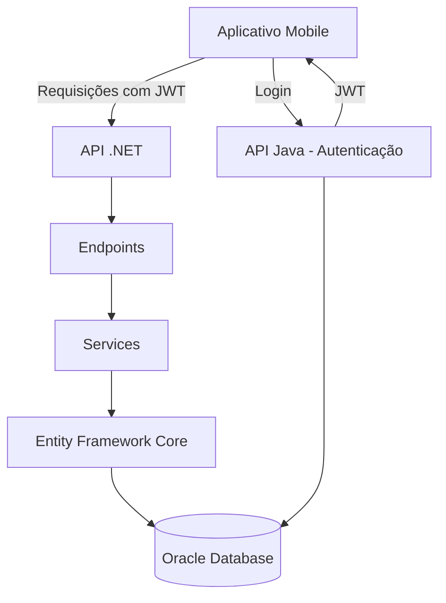

# Partilhaê — API .NET

## Integrantes

| Nome | RM | Turma |
|---|---|---|
| Agatha Yie Won Yun | 561507 | 2TDSA |
| Ana Claudia Fernandes Martins | 561190 | 2TDSR |
| André Rosa Colombo | 563112 | 2TDSA |
| Samantha Faruolo Galdi | 554794 | 2TDSA |
| Vitor Fria Dalmagro | 566052 | 2TDSA |

## Sumário

- [Sobre o projeto](#sobre-o-projeto)
- [Links do projeto](#links-do-projeto)
- [Tecnologias utilizadas](#tecnologias-utilizadas)
- [Funcionalidades](#funcionalidades)
- [Arquitetura](#arquitetura)
- [Estrutura do projeto](#estrutura-do-projeto)
- [Endpoints](#endpoints)
- [Autenticação e autorização](#autenticação-e-autorização)
- [Idempotência](#idempotência)
- [Rate Limiting](#rate-limiting)
- [Health Checks](#health-checks)
- [Testes automatizados](#testes-automatizados)
- [Como executar localmente](#como-executar-localmente)
- [Deploy](#deploy)
- [Projeto acadêmico](#projeto-acadêmico)
- [Uso de Inteligência Artificial](#uso-de-inteligência-artificial)

## Sobre o projeto

O Partilhaê é uma solução CitizenTech desenvolvida para conectar doadores e pessoas que necessitam de ajuda, facilitando o acesso a doações e promovendo a solidariedade.

A API .NET é responsável pelo gerenciamento de solicitações, conversas, mensagens e doações, disponibilizando funcionalidades para integração com o aplicativo Mobile.

## Links do projeto

| Recurso | Link |
|---|---|
| Aplicação online | [API Partilhaê .NET](https://partilhae-net.onrender.com) |
| Documentação | [Swagger .NET](https://partilhae-net.onrender.com/swagger/index.html) |
| Health Check | [Health](https://partilhae-net.onrender.com/health) |
| Repositório Java | [Partilhae_Java](https://github.com/Partilhae/Partilhae_Java) |
> O repositório Java está relacionado a este projeto por ser responsável pela autenticação dos usuários e geração dos tokens JWT utilizados pela API .NET.

## Tecnologias utilizadas

- C#
- .NET 10
- ASP.NET Core Minimal APIs
- Entity Framework Core
- Oracle Database
- SQLite
- Swagger / OpenAPI
- JWT
- xUnit
- Coverlet
- Docker
- Render

## Funcionalidades

- Criação e consulta de solicitações de ajuda.
- Atualização do status das solicitações.
- Criação e consulta de conversas.
- Envio e consulta de mensagens.
- Registro e acompanhamento de doações.
- Confirmação de entrega e recebimento.
- Autenticação e controle de acesso.
- Proteção contra requisições duplicadas.
- Limitação de requisições.
- Monitoramento da saúde da aplicação.
- Bloqueio do envio de mensagens após a conclusão da doação.
- Compartilhamento do banco Oracle com a API Java.

## Arquitetura

A aplicação utiliza uma arquitetura em camadas, separando os endpoints, regras de negócio, contratos de comunicação e acesso ao banco de dados.

Fluxo simplificado:



### Integração com o banco de dados

As APIs Java e .NET utilizam o mesmo banco Oracle, garantindo o compartilhamento dos dados entre os serviços.

A API .NET utiliza Entity Framework Core e consultas SQL parametrizadas para operações específicas do Oracle.

O serviço `OracleChatPermissionService` verifica as permissões de conversa considerando o status das contas dos participantes, da solicitação e da doação, sem depender de packages PL/SQL.

O envio de novas mensagens é bloqueado após o encerramento da doação.

## Estrutura do projeto

```text
Partilhae_Net/
├── Partilhae_Net/
│   ├── Data/
│   ├── DTOs/
│   ├── Endpoints/
│   ├── HealthChecks/
│   ├── Middlewares/
│   ├── Models/
│   ├── Security/
│   ├── Services/
│   ├── Validators/
│   ├── Program.cs
│   └── appsettings.json
├── Partilhae_Net.Tests/
│   ├── Endpoints/
│   ├── Helpers/
│   ├── Integration/
│   ├── Services/
│   └── Validators/
├── Dockerfile
├── .dockerignore
├── .gitignore
├── coverlet.runsettings
└── README.md
```

## Endpoints

### Solicitações

| Método | Rota | Descrição |
|---|---|---|
| POST | `/solicitacoes` | Criar solicitação |
| GET | `/solicitacoes` | Listar solicitações |
| GET | `/solicitacoes/{id}` | Buscar solicitação |
| GET | `/solicitacoes/receptor/{idReceptor}` | Listar solicitações do receptor |
| PATCH | `/solicitacoes/{id}/status` | Atualizar status |

### Conversas

| Método | Rota | Descrição |
|---|---|---|
| POST | `/conversas` | Criar ou buscar conversa |
| GET | `/conversas/usuario/{idUsuario}` | Listar conversas do usuário |
| GET | `/conversas/{idConversa}/mensagens` | Listar mensagens |
| POST | `/conversas/{idConversa}/mensagens` | Enviar mensagem |

### Doações

| Método | Rota | Descrição |
|---|---|---|
| POST | `/doacoes` | Registrar doação |
| GET | `/doacoes/doador/{idDoador}` | Listar doações do doador |
| GET | `/doacoes/solicitacao/{idSolicitacao}` | Consultar doação pela solicitação |
| PATCH | `/doacoes/{id}/status` | Atualizar status da doação |

Os parâmetros, contratos de entrada e saída e códigos HTTP estão documentados no Swagger.

## Autenticação e autorização

A API utiliza JWT integrado à API Java do Partilhaê. O token é gerado durante o login na API Java e reutilizado nas requisições para a API .NET.

```http
Authorization: Bearer TOKEN
```

O controle de acesso considera os perfis:

- ROLE_DOADOR
- ROLE_RECEPTOR

Além do perfil, a aplicação verifica a identidade do usuário e sua relação com os recursos acessados.

Requisições sem autenticação válida retornam HTTP 401. Acessos sem permissão retornam HTTP 403.

## Idempotência

Os endpoints POST aceitam o header opcional:

```http
Idempotency-Key: chave-unica-da-operacao
```

Ao repetir uma requisição com a mesma chave e os mesmos dados, a API retorna a resposta bem-sucedida anteriormente armazenada, evitando a duplicação da operação.

- Chaves com até 100 caracteres.
- Respostas armazenadas por 30 minutos.
- Controle por usuário, rota e chave.
- Conflitos de reutilização retornam HTTP 409.
- Chaves inválidas retornam HTTP 400.

O armazenamento utiliza cache em memória, portanto não persiste após a reinicialização da aplicação.

## Rate Limiting

A API utiliza o mecanismo de Rate Limiting do ASP.NET Core.

- Limite de 100 requisições por minuto.
- Controle por usuário autenticado ou endereço IP.
- Retorno HTTP 429 quando o limite é excedido.

## Health Checks

| Endpoint | Descrição |
|---|---|
| `/health` | Verifica a saúde geral da aplicação |
| `/health/api` | Verifica a saúde da API |
| `/health/db` | Verifica a conexão com o Oracle |

A API .NET realiza a validação do JWT localmente, sem depender de chamadas diretas à API Java durante as requisições.

## Testes automatizados

O projeto utiliza xUnit para testes unitários e de integração, abrangendo:

- Validações.
- Regras de negócio.
- Endpoints REST.
- Autenticação JWT.
- Controle de acesso.
- Idempotência.
- Rate Limiting.
- Health Checks.

Os testes utilizam SQLite em memória e implementações simuladas para funcionalidades específicas do Oracle, preservando os dados do banco compartilhado.

### Resultados

| Indicador | Resultado |
|---|---|
| Total de testes | 249 |
| Testes aprovados | 249 |
| Testes com falha | 0 |
| Taxa de aprovação | 100% |
| Cobertura de linhas | 88,89% |
| Cobertura de branches | 75,56% |

### Executar os testes

```bash
dotnet test
```

### Gerar relatório de cobertura

```bash
dotnet test --settings coverlet.runsettings --collect:"XPlat Code Coverage"
```

### Validação manual com Oracle

Além dos testes automatizados, foi realizada uma validação manual pelo Swagger utilizando o banco Oracle compartilhado e tokens JWT gerados pela API Java.

| Cenário | Resultado |
|---|---|
| Conexão com o Oracle | Aprovado |
| Autenticação com JWT do Java | Aprovado |
| Criação de solicitação | Aprovado |
| Criação de conversa | Aprovado |
| Envio e consulta de mensagens | Aprovado |
| Registro de doação | Aprovado |
| Confirmação de entrega | Aprovado |
| Confirmação de recebimento | Aprovado |
| Atualização do status da solicitação | Aprovado |
| Bloqueio do chat após conclusão | Aprovado (HTTP 403) |

O fluxo completo da doação foi validado, respeitando a sequência de status:

`EM_ANDAMENTO → ENTREGUE → CONCLUIDA`

A integração foi validada localmente sem alterações na estrutura do banco de dados ou no código da API Java.

## Como executar localmente

### Pré-requisitos

- .NET SDK 10
- Git
- Acesso ao banco Oracle do projeto, com schema compatível
- Chave JWT compartilhada com a API Java

### 1. Clonar o repositório

```bash
git clone https://github.com/Partilhae/Partilhae_Net.git
cd Partilhae_Net
```

### 2. Restaurar as dependências

```bash
dotnet restore
```

### 3. Configurar as credenciais

As credenciais devem ser configuradas utilizando User Secrets no ambiente local ou variáveis de ambiente. Nunca devem ser incluídas no repositório.

| Variável de ambiente | Obrigatória? | Descrição |
|---|---|---|
| `ConnectionStrings__Oracle` | Sim, na execução normal | String de conexão com o Oracle, incluindo as credenciais de acesso |
| `JWT_SECRET` | Sim, na execução normal | Chave de assinatura JWT compartilhada com a API Java |

Exemplo de configuração local com User Secrets:

```bash
dotnet user-secrets set "ConnectionStrings:Oracle" "SUA_STRING_DE_CONEXAO" --project Partilhae_Net
dotnet user-secrets set "JWT_SECRET" "SUA_CHAVE_JWT" --project Partilhae_Net
```

A chave JWT deve ser a mesma utilizada pela API Java.

### 4. Executar a aplicação

```bash
dotnet run --project Partilhae_Net
```

Acesse o endereço informado no terminal, seguido de `/swagger`, para visualizar a documentação interativa.

### 5. Testar pelo Swagger

1. Acesse o [Swagger da API Java](https://partilhae-java.onrender.com/swagger-ui/index.html).
2. Faça login com um usuário existente em `POST /auth/login` e copie o token JWT retornado.
3. Abra o Swagger da API .NET, local ou [online](https://partilhae-net.onrender.com/swagger/index.html).
4. Clique em **Authorize** e informe o token JWT, sem o prefixo `Bearer`.
5. Execute os endpoints permitidos ao perfil autenticado. Para uma verificação sem alterar dados do banco compartilhado, utilize endpoints GET.

## Deploy

A aplicação está hospedada no Render utilizando Docker.

As credenciais são configuradas por meio das variáveis de ambiente `ConnectionStrings__Oracle` e `JWT_SECRET`, sem exposição no repositório.

A aplicação utiliza o plano gratuito do Render, que suspende o serviço após 15 minutos de inatividade. Dessa forma, a primeira requisição após esse período pode demorar cerca de 1 minuto para ser respondida.

**Aplicação:** https://partilhae-net.onrender.com

**Swagger:** https://partilhae-net.onrender.com/swagger/index.html

## Uso de Inteligência Artificial

Durante o desenvolvimento do projeto, foi utilizado o ChatGPT (OpenAI) como ferramenta de apoio nas seguintes atividades:

- Planejamento e organização da arquitetura da API.
- Auxílio na implementação e revisão de código.
- Identificação e correção de erros.
- Elaboração de testes automatizados.
- Análise dos relatórios de cobertura.
- Apoio na configuração do deploy.
- Organização e revisão da documentação.

As sugestões geradas pela inteligência artificial foram analisadas, adaptadas e validadas pela equipe, por meio de testes automatizados e manuais.

A inteligência artificial foi utilizada como ferramenta de apoio ao desenvolvimento, não substituindo a responsabilidade técnica dos integrantes.

## Projeto acadêmico

Desenvolvido para a Global Solution 2026 da FIAP, no curso de Análise e Desenvolvimento de Sistemas.

Tema: CitizenTech.